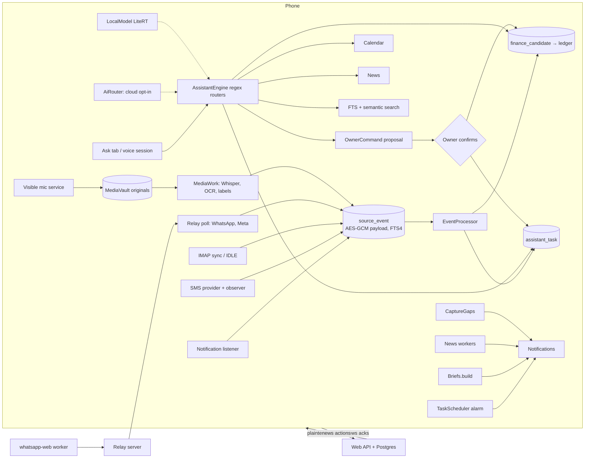
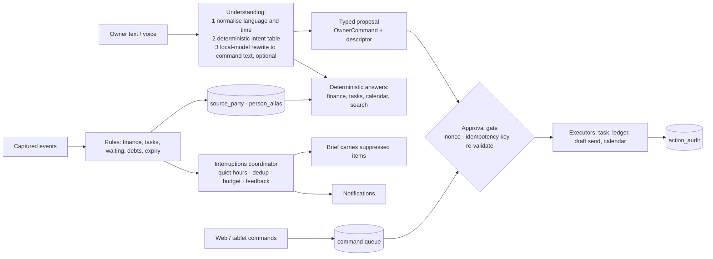

# 04 — Architecture review

Audit target `main @ 85f5ae5`. `A/` = `android/app/src/main/java/com/hellfire/ass/`.

## Actual architecture

The phone is the system. It captures, stores, decides and acts.

Three server pieces support it:
- **Relay** (`server/app`): sealed WhatsApp, Meta and TheftGuard events.
- **WhatsApp worker** (`server/whatsapp-web`): linked-device capture.
- **Web mirror** (`web/api` + `web/frontend`): plaintext read copy, news commands and an encrypted library.

### Strengths (preserve)
- **Capture discipline:** provider-keyed identity, OTP redaction before storage, FTS on redacted text only, bounded queues (05 §1.6).
- **Deterministic finance:**
  - integer ledger with exact arithmetic;
  - evidence links and audit;
  - reversals instead of edits;
  - cross-source duplicate linking (03 §B3).
- **Approval pattern:** nonce, single-use claim, read-back, recovery to UNKNOWN. Used by calendar writes and outbound drafts (03 §C1.1). This is the right base for every external action.
- **Privacy defaults:**
  - cloud off by default;
  - budget reservation;
  - metadata-only AI audit;
  - relay events sealed to the phone key;
  - encrypted library sync.
- **Recovery hooks:** restore receivers, process-start recovery, journaled restore, migration chain with exported schemas.

### Weaknesses
1. **The assistant's understanding layer is a chain of regexes in fixed order** (03 §B1.2). The order decides meaning, so a news word or a generic verb wins over the owner's intent, and the same input means different things in Ask and voice. Most daily-use defects come from here (A1.1–A1.7, D-01–D-07).
2. **Proactive output has no single owner.** Five producers post notifications independently, with three dedup schemes, one set of quiet hours (news only) and no budget (03 §B5).
3. **Three action vocabularies:** `OwnerCommand`, `ActionProposal` and drawer `RecommendedAction`. There is no shared descriptor of risk, approval and verification (03 §C1.2).
4. **People are not first-class in storage.** Person keys exist on ledger, tasks and debts but not on messages, events, memory or transcripts, so cross-source questions cannot be answered (03 §B6).
5. **Hot paths read whole tables and decrypt row by row** without supporting indexes (05 §1.3–1.4).
6. **Failures in release builds are often invisible.** `Diagnostics.warn` is debug-only (05 §2.7).
7. **Breadth outweighs the core loop.** About 44 % of Android code is news, media library, player, sharing and sync; about 28 % is the core loop (10 §E1).

## Target architecture

The target keeps the phone authoritative and changes three seams. It adds no new framework.

### Component responsibilities
| Component | Responsibility | Built from |
|---|---|---|
| Understanding | Parse time, amounts and intent once, the same way for Ask, voice and widgets | `TaskExtractor`, `SwahiliTime`, `SwahiliAmount`, `QueryDates`, `AssistantCommands.parse` |
| Intent table | Ordered rules with explicit exclusions (a news word does not win over a finance word) and one place to test them | `AssistantEngine.answer` |
| Model rewrite (optional) | Turn an unparsed imperative into one canonical command line that the deterministic parser then validates | `LocalModel`, B1.6 |
| Approval gate | One path for every side effect: proposal snapshot, idempotency key, re-validation, nonce for external sends | `runConfirmedCommand`, calendar and draft state machines |
| Coordinator | Decide interrupt, defer to brief, or drop | `NewsAlerts.decide`, `CaptureGaps` signature, `Briefs` |
| Identity | Map handles to people for every source | `Handles.key`, `person_alias`, new `source_party` |
| Command queue | Web, tablet or desktop request; phone applies | news actions channel (Multi-device below) |

### Migration strategy
Each step is backward compatible and shippable alone:
1. Fix parsers and routing in place (HF-001–HF-006). No schema change.
2. Add indexes (v22, HF-020). Index-only migration, so the backup format is unchanged.
3. Add idempotency and snapshots to owner commands (HF-014). No schema change.
4. Introduce the coordinator with a `notice_log` table (HF-032). The new table is excluded from portable backup until stable, then added with a backup-format version bump.
5. Add `source_party` with a backfill worker that reuses the `SearchBackfill` pattern (HF-031).
6. Generalize the news-actions queue into commands (HF-061). It uses a new server table; the old news-action route is kept until the phone no longer uses it.

---

## Multi-device

### D1. Three separate channels exist today

| Channel | Direction | Data | Server can read it? | Auth | Code |
|---|---|---|---|---|---|
| **1. Plaintext mirror** | phone → server (push only) | 19 kinds: `account, ledger, candidate, balance, task, message, draft, media, transcript, memory, event, summary` plus 7 `news_*` kinds | **Yes.** Stored as plain JSONB in `record(kind,id,at,data)` | Phone: one static bearer `SYNC_TOKEN`. Browser: owner session | `A/sync/WebSync.kt` (351), `web/api/src/sync.ts` (100), `view.ts` (145), `db.ts:8-15` |
| **2. News actions** (the only web→phone command channel) | browser → server queue → phone pulls, applies, acks, then pushes merged state | `seen`, `bookmarked`, `readLater`, `hidden`, `followed`, briefing `position` | Yes (plain) | Browser session writes it. Phone `SYNC_TOKEN` pulls and acks | `web/api/src/news.ts` (262), `A/news/NewsSync.kt` (78), `WebSync.kt:174-180,221-241` |
| **3. Encrypted library sync** | **multi-master**: phone ⇄ server ⇄ browser | 15 entity types (`media_item … transcript_segment`, `saved_location`, `drawer_message`, `action_record`) plus original blobs | **No** for bodies and originals (AES-GCM under a passphrase key). The server sees HMAC ids, sizes, timing and `deviceId` | `ClientGuard` (`SYNC_TOKEN` **or** an owner session). Key-check init is phone-only | `A/sync/LibrarySync*.kt` + `LibraryClient.kt` (1,241 LOC), `web/api/src/library.ts` (268), `web/frontend/lib/library-app.tsx` (325) + `library-crypto.ts` (74) |

**Plaintext mirror mechanics: VI**
- Every 15 min (network connected, battery not low): `WebSync.kt:272-283`.
- The phone keeps an encrypted id→hash map per kind in SecretStore, tied to the server's `dataset` UUID (`WebSync.kt:171-219`). A mismatched dataset triggers `POST /api/sync/reset` and a full copy (`:181-182`, `sync.ts:50-59`).
- Batches are capped at ≤300 rows / ~1 MB (`:40-41,213`). The server caps 500 rows (`sync.ts:11`) and 4 MB bodies (`app.ts:29`). State is saved after each kind, so an interrupted pass resumes per kind (`:218`).
- The month totals and balances are computed on the phone (`summary` row, `:152-165`). The server never derives anything.

**Exclusion filters: VI**
- `securitySensitive = 0` joins on candidate, task, message, memory and event (`:72,75,77,82,87`).
- Event payloads are decrypted only for uploaded rows, with an allow-list of fields (`:67,88-91`).
- Media/transcripts are mirrored only when `syncEnabled = 0`, which keeps them out of the plaintext mirror once they are in encrypted library sync (`:79-80`).
- `news_source` never carries the X token (`:119`).
- Tests: `WebSyncTest` (8, incl. "never security-sensitive ones", "contact picks … stay out").

**Transport: VI**
- HTTPS only, no userinfo, query or fragment. Token length 32–512 (`:123-127`).
- No redirects, 1 MiB reply cap (`:244-270`).
- The browser never calls the API directly: Next.js keeps the token in an HttpOnly, Secure, SameSite=Strict cookie (`web/frontend/app/actions.ts`). Only `/api/sync/*` is rewritten to the API (`next.config.ts:9`). The library goes through the `app/api/library/[...path]/route.ts` allow-list (`state, key-check, salt, blobs, records, changes`).

**Encryption verdict.**
- **VI:** the mirror is readable by whoever controls the server, Postgres and its backups. This is deliberate (DECISIONS "Web access (2026-11-16)": E2E rejected so the server can list and search). Search is `data::text ILIKE` (`view.ts:93`, `news.ts:194`).
- **VI:** library bodies and originals are opaque to the server. Local ids, tag text and plaintext hashes are inside the ciphertext. Record ids and blob dedupe keys are HMACs (`LibrarySync.kt:57-62,138-146`). Uploading `searchText` is refused (`library.ts:43`).
- **IR:** the browser decryption code (`library-app.tsx`) is served by the same server, so a compromised server could ship JS that captures the passphrase. That is the standard limit of web E2E. Nothing pins or verifies the frontend bundle.

### D2. What the web can change

| Web capability | Exists? | Evidence |
|---|---|---|
| Read overview, money, tasks, inbox, recordings, memory, news, search, library | VI | `app/(site)/layout.tsx:4` (9 nav links) |
| Approve payments, tasks or drafts | **M**. Counts only (`toConfirm`, `tasksToReview`, `draftsWaiting`) | `view.ts:55-60`; no POST routes besides news/library/auth |
| Edit tasks, ledger or memory | **M** | Ditto |
| News flags, read version, briefing position | VI | `news.ts:13-14,207-213`; `news/reader.tsx:57,66,103` |
| Library notes, collection names/descriptions, categories, bookmarks; browser upload of originals ≤256 MiB | VI | `library-app.tsx:36,150-170,230,309-323` |

**How news actions work (VI):**
1. The browser posts `{target, field, value}` to `POST /api/news/action`. It is validated against an allow-list (`news.ts:32-50`) and throttled to 120/min (`:251`).
2. The server stamps `at = Date.now()` and a `bigserial seq` (`:207-213`, `db.ts:61-67`).
3. The views overlay pending actions on the phone's last state with `pending: true` (`effectiveState` / `effectiveProgress`, `:53-85`).
4. The phone pages `GET /api/sync/news-actions?after=` (≤20×500) **before** pushing (`WebSync.kt:174-180,229-241`). It applies them through `NewsSync.apply`: last writer wins per field against `fieldTimes`, `seen` only grows, position only if newer (`NewsSync.kt:23-77`). Unknown targets are dropped.
5. The phone pushes its merged state, calls `finish`, then `ack upTo=seq`, which deletes the actions (`WebSync.kt:220-224`, `news.ts:222-227`).
6. A re-apply after an interrupted pass is a no-op, because each field's time has advanced.
7. A mirror reset clears `news_action` (`sync.ts:56`).
8. Tests: `NewsSyncTest` (4), `WebSyncTest` "web news choices are applied before the push and then acknowledged", plus API tests "overlays pending web choices … last writer wins per field" and "lets the phone pull actions in order and acknowledge them".

**Issues in this area:**
- **IR (clock skew):** the action `at` uses the server clock, but it is compared with phone-clock `fieldTimes` (`news.ts:209`, `NewsSync.kt:62`). If the server clock lags the phone's last local edit to that field, the web choice is silently dropped. Impact is low for news; it would matter if the pattern were generalized.
- **VD (documentation):** README "Web access (read-only mirror)" (README ~l.651ff: "the site only displays that copy") and DECISIONS "phone as the only writer … no conflict handling" are contradicted by the news-action channel and by multi-master library editing with a `sync_conflict` table.

### D3. Resumable large transfers (library blobs): VI

- **Chunking:** 256 KiB chunks (`LibrarySync.kt:32`). Each chunk is sealed with AAD `library-chunk-v1:<plainHash>:<index>`, so chunk order and file identity are authenticated (`:264-283`).
- **Resume is driven by the server:** `POST /blobs` returns `received[]` and `complete` for an existing HMAC dedupe key (`library.ts:104-135`).
- **Idempotent writes:** `putChunk` checks size against the blob geometry, verifies the per-chunk SHA-256 of the ciphertext, and accepts a re-put with the same hash but rejects a different one (`:137-163`).
- **Quota:** default 8 GiB under an advisory lock (`config.ts:28`, `library.ts:127-128`).
- **Garbage collection:** unreferenced blobs are removed after 24 h (`:93-102`).
- **Retries:** 429 retries with backoff (`LibraryClient.kt:27-35`). Each pass is bounded to 8 min and continues next run (`LibrarySyncWorker.kt:66-73,91`).
- **Browser download:** 3 concurrent chunk GETs with chunk- and file-level checks (DECISIONS 2026-11-17).
- **Tests:** API "uploads chunks, resumes, verifies hashes…", "rejects inconsistent geometry…", "expires abandoned uploads…"; `LibrarySyncTest` / `LibrarySyncReviewTest` (14+16).
- The plaintext mirror carries **no** originals or thumbnails (README).

### D4. Device identity and revocation

| Aspect | Finding | Label |
|---|---|---|
| Phone identity on the mirror | None. One shared static bearer `SYNC_TOKEN` (`config.ts:22`, `auth.ts:55-63`) | VI (single-device design) |
| Library device id | Self-asserted UUID: SecretStore on the phone (`LibrarySyncRecords.kt:143-149`), `localStorage` in the browser (`library-app.tsx:39-46`). Stored in `library_record.device_id` (`db.ts:41`) but never authenticated. Used only to skip echoes of the device's own changes (`LibrarySyncWorker.kt:238`) | VI; IR if used for trust |
| Browser sessions | Stateless HMAC tokens, 12 h (`auth.ts:9,27-37`). Logout writes `sessions_after` and revokes **all** sessions (`db.ts:88-91`, `view.ts:134-135`). Login limited 5/min per `X-Real-IP` | VI |
| Revoking one device | **M.** No device registry. Revoking the phone means rotating `SYNC_TOKEN` in `web/.env`, restarting, and re-entering it on the phone. The same token also grants library read/write and `/api/sync/reset` (wipe) | M |
| Library key rotation | **M (by design).** Changing the key of a nonempty library is blocked (DECISIONS 2026-11-17) | VI limitation |
| "Turn off and delete the web copy" | Wipes only the plaintext mirror (`WebSync.kt:307-316` → `/api/sync/reset`). The encrypted library and salt are **preserved** (API test "preserves encrypted library records and salt when the ordinary web mirror resets"). There is no library wipe route (`library.ts:251-268`) | **M**: no remote erase of library ciphertext from the phone |
| Phone → server connectivity | **BLOCKED.** `hellfire.local` exists only in this PC's `/etc/hosts`, and the app trusts only system CAs (DEVICE_FEASIBILITY "Web access — 2026-11-16", README Web access). None of the multi-device paths have ever run end to end with a phone | VI (documented) |

### D5. Duplicates and multiple capturing devices

- **IR (high, deterministic from code):** a second Android install (for example a tablet) pointed at the same server would make the two devices reset each other's dataset forever.
  - Each device keeps its own `dataset` in state. A mismatch calls `/api/sync/reset`, which deletes all rows and `news_action` (`WebSync.kt:172-182`, `sync.ts:50-59`).
  - Each 15-min pass would then become a full copy of one device's data, wiping the other's.
  - Nothing refuses a second phone.
- **VI:** capture dedupe is per-install only: `source_event` is unique on `(source, externalId)` (`A/data/EventDatabase.kt:76`).
  - Cross-channel finance duplicates are handled (`finance_candidate.duplicateOf`, v13, `EventDatabase.kt:323-326`).
  - The WhatsApp relay keys include the account (`GatewayEvents.kt:19`).
- **M:** no evidence of cross-device notification dedupe. It is moot while only one phone captures, which is the right invariant to keep.

### D6. Hypothesis: "the phone stays authoritative; other clients send commands the phone approves and applies" is simpler and safer than multi-master

**Supported by code evidence.**

| | News-action channel (command pattern) | Library sync (multi-master) |
|---|---|---|
| Android LOC | `NewsSync.kt` 78 + ~25 in `WebSync.kt` | 1,241 (`LibrarySync`, `Worker`, `Records`, `Client`) |
| Server LOC | ~60 in `news.ts` (+ overlay views) | 268 `library.ts` |
| Browser LOC | ~18 (`news/actions.ts`) | ~400 |
| State machinery | seq cursor + ack | per-field clocks, 3-way merge (`LibrarySync.kt:181-217`), `sync_record` / `sync_conflict` tables, parked records, epochs, protocol-1→2 in-place upgrade, legacy blob grace |
| Tests | 4 Android + ~3 API | 30 Android + ~14 API |
| Review defects | none recorded | 2026-11-17 "Sequential sync/web review" fixed several merge, park and upgrade paths |

- **VI:** the news channel already **is** the command pattern: typed allow-list, server-ordered queue, phone-side rule application, ack, then authoritative re-push, with an optimistic overlay in the UI.
- It is **not signed**. Integrity rests on TLS, the owner password and a trusted server. A compromised server can forge actions. That is harmless for news flags, but not acceptable for approvals or sends.

**PE: generalize the channel instead of extending multi-master.**
- Replace `news_action` with a typed `command(seq, at, kind, target, base_hash, payload, sig?, status, result)` table.
- Starting kinds: `task.done | snooze | reschedule`, `candidate.confirm | dismiss {accountId, category}`, `draft.approve | edit | discard`, `memory.forget`, `inbox.note`.
- **Stale-command guard:** the phone already holds the exact hash of every row it last pushed (WebSync `held` id→hash map, `WebSync.kt:185,195`). A command carries `base_hash`, and the phone rejects it if the row has changed. No merge logic is needed.
- The phone posts `status` / `result` back, so the web shows applied, rejected or stale results instead of an optimistic overlay alone.
- **Side effects (send or post money):** two options.
  - (a) The web command only *stages*. The phone shows a local "Approve from web?" notification, which keeps AGENTS.md "user-approved by default" literal.
  - (b) Per-client signing: a non-extractable WebCrypto ECDSA key enrolled by QR on the phone. The phone stores the public keys, which gives a **device registry and per-device revocation** for free.
- Optional E2E for command payloads: seal them to the phone's public key, reusing the relay's existing `seal()` approach (DECISIONS 2026-11-25).
- Use the phone clock for LWW, or plain seq order, to avoid the D2 skew.

**Recommendation for library sync:** freeze it rather than extend it. If library editing in the browser is low-use, consider converting the browser edits (notes, bookmarks) into commands too. That would allow eventual removal of the 3-way merge (PE).

### D7. Intended clients

| Client | What exists | Verdict |
|---|---|---|
| **Bedside Android tablet** | No `WindowSizeClass`, adaptive navigation suite or two-pane layouts. The only width-awareness is `DrawerHost.kt:69,118` (`screenWidthDp` fraction) and `LibraryPage.kt:170` (`GridCells.Adaptive`). Manifest `resizeableActivity="true"` (`AndroidManifest.xml:91`). Installing the app on a tablet creates a second **independent** instance (own SQLCipher DB, capture, keystore) and triggers the D5 reset ping-pong | **M** (layouts). **IR** (second install). PE: treat the tablet as a browser/PWA client of the web workspace with a "bedside" page (next alarms, brief, news audio); do not ship a second Android app instance |
| **Arch/KDE desktop** | Nothing native. MASTER_SPEC §Phase 6 "desktop dashboard if desired" (l.714). README: "Telegram and desktop dashboard have not been added". The web stack already runs on this PC (`https://hellfire.local`, systemd units) | **M** (native). PE: the web workspace *is* the desktop client. **UA:** KDE Connect mirrors Android notifications, SMS and clipboard to Plasma independently of HellFire; I did not verify that a third-party app can add KDE Connect plugins without forking KDE Connect Android. It would add a duplicate notification surface, not HellFire data. Treat it as optional and orthogonal |
| **Web workspace** (approvals, editing, finance, search) | Read views plus filters/paging (`view.ts:77-112`); finance read-only from the phone `summary` row; search is a sequential plaintext `ILIKE` (no FTS index); encrypted library search runs in the browser after decryption | Approvals and editing **M** → the D6 command channel is the natural path. **IR:** `ILIKE` over `data::text` scales linearly. Fine for one owner, and it also matches JSON keys |

**IR (phone cost):** each mirror pass re-reads and re-hashes **every** row of every kind (`WebSync.kt:134-149,190-196`), including the full message history, every 15 min. Payloads are decrypted only for changed rows. CPU and battery cost on a large corpus is NOT TESTED.

---

